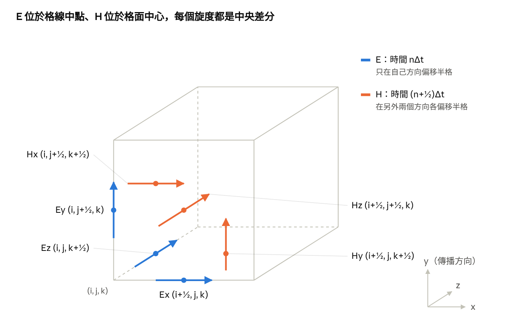
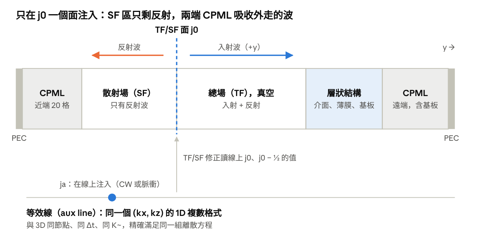
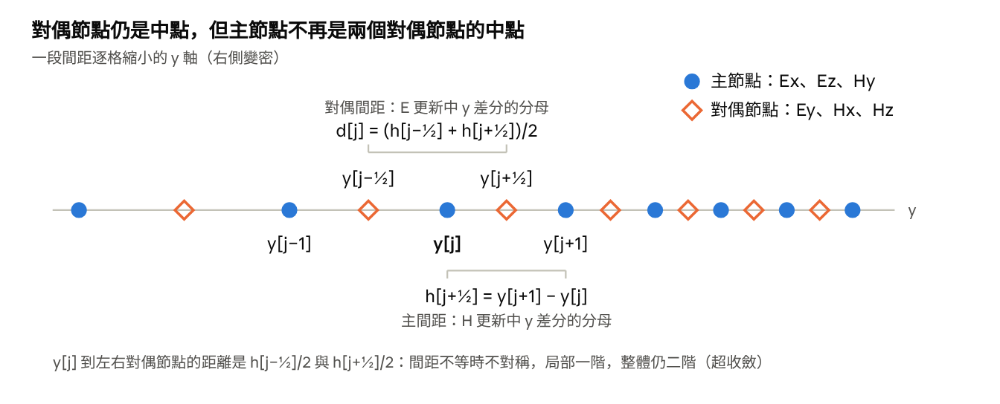
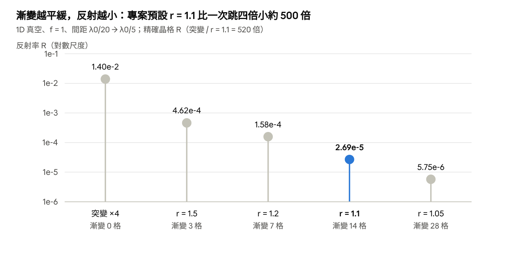

# 3D Yee FDTD 斜入射推導講義：從均勻網格到非均勻網格

2026-11-05

## 導讀

這份講義從 Maxwell 方程一路推到本專案求解器 `3D_oblique/fdtd3d_oblique.c` 實際使用的更新式，回答三個問題：Yee 格式為什麼長這樣？斜入射平面波怎麼精確注入？網格間距不相等時，哪些地方要改、哪些性質仍然成立？每一個結論都對應一項驗證關卡，最後一章列出理論值與量測值。

**適合的讀者**：學過向量微積分與 Maxwell 方程、知道泰勒展開與有限差分的研究生或工程師。不需要先學過 FDTD。

**閱讀路線**：

1. 第 1–4 章是均勻網格的基礎：單位、Yee 格點、時間推進與穩定、數值色散。
2. 第 5–6 章處理斜入射：週期邊界、把 3D 化成 1D 的等效線、平面波注入與吸收邊界。
3. 第 7–9 章把前面的結果推廣到非均勻網格，並說明守恆與穩定為什麼仍成立。
4. 第 10 章是驗證對照表，可以拿來檢查自己的實作。

只想了解非均勻網格的讀者，讀完第 2–4 章後可以直接跳到第 7 章（9.3 節另需第 5 章的等效線）。

**符號與單位約定**（全講義通用）：

| 符號 | 意義 | 第一次出現 |
| --- | --- | --- |
| c, ε0, μ0 | 真空光速、真空介電常數、真空磁導率，正規化為 1 | 第 1 章 |
| λ0, ω0, T0 | 參考波長 1、角頻率 2π、週期 1 | 第 1 章 |
| ε, μ | 相對介電常數、相對磁導率 | 第 1 章 |
| kx, ky, kz | 平面波波數分量，y 為傳播方向 | 第 1 章 |
| Δ, Δt | 均勻網格的空間間距、時間步長 | 第 2 章 |
| (i, j, k), n | 空間格點索引、時間步索引 | 第 2 章 |
| S = cΔt/Δ | Courant 數，本專案預設 0.5 | 第 3 章 |
| K\~, ω\~ | 離散波數、離散角頻率（空間、時間差分算子的特徵值分別為 iK\~、−iω\~） | 第 4 章 |
| h, d | 非均勻網格的主間距、對偶間距 | 第 7 章 |
| W | 非均勻網格的內積權重 | 第 8 章 |

時諧慣例一律為 f(t) = Re\[F e^{−iωt}\]，所以時間導數對應 −iω，損耗介質的 Im ε > 0。

## 第 1 章 Maxwell 方程與正規化單位

FDTD 只需要 Maxwell 的兩個旋度方程；把光速、ε0、μ0 和參考波長 λ0 都設成 1 之後，方程裡就只剩材料參數 ε、μ 與幾何，結果對任何波長都適用。

### 1.1 旋度方程

在沒有自由電荷與電流、線性且各向同性的介質中，Maxwell 方程的兩條旋度式為（Faraday 定律與 Ampère–Maxwell 定律）：

$$
\mu_0\mu\thinspace \frac{\partial \mathbf H}{\partial t} = -\nabla\times\mathbf E,\qquad \varepsilon_0\varepsilon\thinspace \frac{\partial \mathbf E}{\partial t} = \nabla\times\mathbf H
$$

另外兩條散度式 ∇·D = 0、∇·B = 0 不必單獨求解：對旋度式取散度，因為 ∇·(∇×F) = 0，散度不隨時間改變；只要初始時為 0，就永遠為 0。第 2 章會看到 Yee 格式在離散層次也保留了這個性質（資料來源：Jackson, *Classical Electrodynamics*, 3rd ed., §6.1；Taflove & Hagness, *Computational Electrodynamics*, 3rd ed., 第 3 章）。

### 1.2 正規化單位

取參考波長 λ0 為長度單位、λ0/c 為時間單位，並把磁場乘上真空阻抗 η0 = √(μ0/ε0)：

$$
x' = \frac{x}{\lambda_0},\quad t' = \frac{c\thinspace t}{\lambda_0},\quad \mathbf E' = \mathbf E,\quad \mathbf H' = \eta_0\thinspace \mathbf H
$$

代回 1.1 的兩式，所有常數恰好消去，得到 μ ∂H/∂t = −∇×E 與 ε ∂E/∂t = ∇×H，等同於 c = ε0 = μ0 = 1。由此可得：

| 量 | 正規化後的值 | 說明 |
| --- | --- | --- |
| λ0 | 1 | 長度單位 |
| T0 = λ0/c | 1 | 一個光學週期 |
| ω0 = k0 = 2π/λ0 | 2π | 角頻率與真空波數相等 |
| η0 | 1 | E 與 H 同單位 |
| 頻率 f = λ0/λ | 無單位 | 寬頻計算時用來換算波長 |

**為什麼可以這樣做**：Maxwell 方程對空間與時間同時縮放保持不變（尺度不變性）。所以同一個模擬可以代表 530 nm 或 1.55 µm，只是單位換算不同。本專案的 `oblique.py` 就是這樣把物理波長轉成求解器參數。例外是色散材料：它的 ε(ω) 帶有特定的共振頻率，所以要指定 λ0 的物理值（堆疊檔的 `lambda0_um`）。

### 1.3 時諧場與連續色散關係

後面每一章都用時諧平面波來分析格式，所以先定下慣例。將場寫成

$$
\mathbf F(\mathbf r,t) = \mathrm{Re}\big[\mathbf F_0\thinspace e^{i(\mathbf k\cdot\mathbf r-\omega t)}\big]
$$

則 ∂/∂t → −iω、∇ → ik。代入 1.1 得 ωμH0 = k×E0 與 −ωεE0 = k×H0，消去 H0 並利用 k·E0 = 0，得到連續的色散關係：

$$
|\mathbf k|^2 = k_x^2+k_y^2+k_z^2 = \varepsilon\mu\thinspace \omega^2
$$

第 4 章會推出離散版本，並拿它和這條式子比較：兩者的差異就是「數值色散」。此慣例下，損耗介質的 Im ε > 0，往 +y 傳播的波取 Re ky > 0。

## 第 2 章 Yee 格點：交錯排列與中央差分

把六個場分量放在互相錯開半格的位置，每一個空間導數就都是兩個鄰居的中央差分，精度為二階。這是 Yee 在 1966 年提出的配置（K. S. Yee, IEEE Trans. Antennas Propag. 14(3), 302–307, 1966）。

### 2.1 中央差分與它的誤差

對光滑函數 f，在 x 兩側各取半格做泰勒展開，偶次項相消：

$$
\frac{f(x+\tfrac{\Delta}{2})-f(x-\tfrac{\Delta}{2})}{\Delta} = f'(x) + \frac{\Delta^2}{24}f'''(x) + O(\Delta^4)
$$

所以「差分的結果放在兩個樣本的正中間」時，截斷誤差是 O(Δ²)。若結果放在其中一個樣本上（前差或後差），f'' 這一項（偶次項）不會相消，誤差退化為 O(Δ)。「差分結果要落在中點」就是後面決定所有分量位置的唯一規則。

### 2.2 六個分量放在哪裡

以 Ampère 定律的 x 分量為例：ε ∂Ex/∂t = ∂Hz/∂y − ∂Hy/∂z。要讓兩個導數都是以 Ex 為中點的中央差分，Hz 必須在 Ex 的 y ± Δ/2，Hy 必須在 Ex 的 z ± Δ/2。對六個分量同時要求這件事，得到的唯一自洽配置（差一個整體平移）是：

- **Eα 只在自己的方向 α 偏移半格**，位於格線的中點。
- **Hα 在另外兩個方向各偏移半格**，位於格面的中心。
- **時間上 E 在整數步、H 在半整數步**，讓時間導數也是中央差分（第 3 章）。

| 分量 | 空間位置（以 Δ 為單位） | 時間 |
| --- | --- | --- |
| Ex | (i+½, j, k) | nΔt |
| Ey | (i, j+½, k) | nΔt |
| Ez | (i, j, k+½) | nΔt |
| Hx | (i, j+½, k+½) | (n+½)Δt |
| Hy | (i+½, j, k+½) | (n+½)Δt |
| Hz | (i+½, j+½, k) | (n+½)Δt |

這張表就是求解器裡 `OFF[6][4]` 陣列的內容（`fdtd3d_oblique.c`），後處理程式也依此計算每個分量的座標。

### 2.3 一條完整的更新式

把 2.1 的中央差分代入 Ex 的 Ampère 式，時間也用中央差分（中點在 (n+½)Δt，正好是 H 的時刻）：

$$
E_x\big|^{n+1}_{i+\frac12,j,k} = E_x\big|^{n}_{i+\frac12,j,k} + \frac{\Delta t}{\varepsilon\thinspace \Delta}\Big[H_z\big|^{n+\frac12}_{i+\frac12,j+\frac12,k} - H_z\big|^{n+\frac12}_{i+\frac12,j-\frac12,k} - H_y\big|^{n+\frac12}_{i+\frac12,j,k+\frac12} + H_y\big|^{n+\frac12}_{i+\frac12,j,k-\frac12}\Big]
$$

其餘五條可用同樣方法得到（Taflove & Hagness 第 3 章）。注意式中不需要任何內插：右邊的每一個 H 就是陣列裡存的值。

### 2.4 離散散度自動為零

定義節點 (i, j, k) 上的離散散度為三個方向的中央差分之和。介質中要對 D = εE 取散度（每個 E 分量先乘上自己位置的 ε）：E 的更新式是 ε(Eⁿ⁺¹ − Eⁿ) = Δt ∇h×Hⁿ⁺½，把三條代進去，每一個 H 都恰好以一正一負出現兩次（不同軸的差分算子可交換），所以

$$
\nabla_h\negthinspace \cdot\negthinspace (\varepsilon\mathbf E^{n+1}) = \nabla_h\negthinspace \cdot\negthinspace (\varepsilon\mathbf E^{n}) \quad(\text{無源區})
$$

這就是 1.1 「∇·D 不隨時間改變」的離散版本；均勻介質（或真空）中 ε 可以提出，才簡化成 ∇h·E 不變。H 的散度同理（μ 乘在 H 上）。專案的 gate 0-5 在非均勻網格上量測這個量（差分分母依第 7 章換成 d），結果為捨入誤差等級（第 10 章）。

下圖是一個 Yee 單元格內六個分量的位置。



例：Ex 旁邊上下各有一個 Hz、前後各有一個 Hy，所以 ∂Hz/∂y 與 ∂Hy/∂z 都以 Ex 為中點。虛線是被遮住的稜。

## 第 3 章 蛙跳時間推進與 Courant 穩定條件

E 與 H 輪流更新（蛙跳），每一步只用到已知的值，不必解聯立方程；代價是時間步長有上限：均勻 3D 網格需 S = cΔt/Δ ≤ 1/√3 ≈ 0.577，本專案取 S = 0.5。

### 3.1 蛙跳格式

時間軸上，E 放在整數步 n、H 放在半整數步 n+½。每一步分兩個半步：

1. 用 Eⁿ 計算 ∇×E，把 H 從 n−½ 推到 n+½（Faraday）。
2. 用 Hⁿ⁺½ 計算 ∇×H，把 E 從 n 推到 n+1（Ampère）。

兩個時間導數都以另一個場的時刻為中點，所以和空間一樣是二階精確。對應到程式，就是主迴圈裡 `update_H()` 與 `update_E()` 的交替呼叫。這種格式是「顯式」的：每個分量的新值只依賴周圍的舊值，計算量與格點數成正比。

### 3.2 為什麼時間步長有上限

第 4 章會推出均勻 Yee 格式的離散色散關係（真空、c = 1）：

$$
\sin^2\frac{\omega\Delta t}{2} = S^2\sum_{a=x,y,z}\sin^2\frac{k_a\Delta}{2},\qquad S = \frac{c\thinspace \Delta t}{\Delta}
$$

右邊最大可到 3S²（每個方向都取最短可解析波長）。若 3S² > 1，就有某些 k 讓右邊大於 1；左邊的 sin² 對實數 ω 不可能超過 1，所以 ω 只能是複數，對應的模態每一步指數增長。所以穩定條件是

$$
S < \frac{1}{\sqrt{3}}\quad(\text{3D 均勻}),\qquad S < 1\quad(\text{1D})
$$

等號是臨界情形：最短波長模態的 ωΔt = π 成為重根，若網格上存在這個模態，它會線性（不是指數）增長，所以求解器要求嚴格小於。這就是 Courant–Friedrichs–Lewy（CFL）條件在 Yee 格式上的形式（R. Courant, K. Friedrichs, H. Lewy, *Math. Ann.* 100, 32–74, 1928；Taflove & Hagness 第 4 章）。直觀解釋：顯式格式每一步只能把訊號傳到相鄰格點，所以物理上的波在一個時間步內走過的範圍，必須被數值格式在一步內能「看到」的範圍包住（數值影響域要包含物理影響域）。精確的上限 1/√3 仍以上面的色散分析為準。

### 3.3 程式 demo：跨過上限的瞬間

下面是 1D Yee 格式（Ez 在整數節點、Hy 在半整數節點，兩端 PEC）。初始時只有中間一點有值，它包含最短可解析波長的成分，所以恰好會暴露不穩定模態。

```python
import numpy as np

def run(S, N=200, steps=2000):
    """1D Yee in vacuum (c = 1, dx = 1): Ez on integer nodes, Hy on half nodes, PEC ends."""
    E = np.zeros(N + 1); H = np.zeros(N)
    E[N // 2] = 1.0                       # initial pulse
    for n in range(steps):
        H += S * (E[1:] - E[:-1])         # dt/dx = S
        E[1:-1] += S * (H[1:] - H[:-1])
    return np.abs(E).max()

for S in (0.5, 0.99, 1.0, 1.01, 1.05):
    print(f"S = {S:4.2f}   max|E| after 2000 steps = {run(S):.3e}")
```

輸出：

```text
S = 0.50   max|E| after 2000 steps = 1.440e-01
S = 0.99   max|E| after 2000 steps = 3.760e-01
S = 1.00   max|E| after 2000 steps = 1.000e+00
S = 1.01   max|E| after 2000 steps = 4.983e+243
S = 1.05   max|E| after 2000 steps = nan
```

S 只超過上限 1%，2000 步後場就增長到 10²⁴³；上限內則永遠有界。S = 1 是 1D 的臨界值，也是「魔術步長」：此時數值色散恰好為 0，脈衝每步前進一格而不變形。這裡 S = 1 仍有界，是因為兩端 PEC 讓 E 節點上不存在 kΔ = π 的模態（sin(πj) ≡ 0），臨界的重根模態不會被激發。

### 3.4 本專案的選擇

求解器拒絕 S ≥ 1/√3（`setup()` 中檢查）。預設 S = 0.5、Δ = λ0/20，所以 Δt = 1/40，一個光學週期恰好 40 步，讓整數週期的 DFT 沒有截斷誤差。第 8 章會看到，非均勻網格的上限改由「最小間距」決定。

## 第 4 章 數值色散：離散平面波

Yee 格式有一個「精確」的平面波解，只是它的波數與連續解略有不同：Δ = λ0/20 時，本專案預設斜入射的 ky 偏差 7.58×10⁻³（相對 0.15%），網格每加密一倍偏差縮為 1/4。

### 4.1 差分算子的特徵值

對指數函數 f = e^{ikx}，第 2 章的中央差分不是近似，而是精確地等於「乘以一個常數」：

$$
\frac{e^{ik(x+\Delta/2)}-e^{ik(x-\Delta/2)}}{\Delta} = i\tilde K\thinspace e^{ikx},\qquad \tilde K \equiv \frac{2}{\Delta}\sin\frac{k\Delta}{2}
$$

時間上同理，對 e^{−iωt} 得到 −iω\~，其中 ω\~ = (2/Δt) sin(ωΔt/2)。這兩個量稱為**離散波數**與**離散角頻率**：它們是差分算子的特徵值。當 kΔ → 0 時 K\~ → k，回到連續情形。

### 4.2 離散 Maxwell 與色散關係

把 F = Re\[F0 e^{i(k·r − ωt)}\]（每個分量在自己的 Yee 點與時刻取樣）代入離散更新式，等於在連續 Maxwell 裡把 ∇ 換成 iK\~、∂/∂t 換成 −iω\~：

$$
\tilde\omega\thinspace \mu\thinspace \mathbf H_0 = \tilde{\mathbf K}\times\mathbf E_0,\qquad -\tilde\omega\thinspace \varepsilon\thinspace \mathbf E_0 = \tilde{\mathbf K}\times\mathbf H_0
$$

與 1.3 的推導完全相同，得到 |K\~|² = εμ ω\~²，展開即為（εμ = n²）：

$$
\Big(\frac{n}{S}\Big)^2\sin^2\frac{\omega\Delta t}{2} = \sin^2\frac{k_x\Delta}{2}+\sin^2\frac{k_y\Delta}{2}+\sin^2\frac{k_z\Delta}{2}
$$

第 3 章的 Courant 條件就是從這條式子來的。要注意：相位裡用的仍是真實的 k 與 ω，K\~ 與 ω\~ 只出現在振幅與偏振的關係中。

### 4.3 斜入射時解出 ky

斜入射時 kx、kz 由週期邊界決定（第 5 章），只有 ky 未知。由上式可解出

$$
Q \equiv \sin^2\frac{k_y\Delta}{2} = \Big(\frac{n}{S}\Big)^2\sin^2\frac{\omega\Delta t}{2}-\sin^2\frac{k_x\Delta}{2}-\sin^2\frac{k_z\Delta}{2},\qquad k_y = \frac{2}{\Delta}\arcsin\sqrt{Q}
$$

求解器在啟動時檢查 0 < Q ≤ 1。Q ≤ 0 表示這個模態在此網格上是消逝波，Q > 1 則沒有實數解；兩種情形都直接報錯，不會產生 NaN（`ky_local()`）。

### 4.4 程式 demo：偏差是二階的

預設參數：Lx = 2、Lz = 3、m = n = 1（kx/k0 = 0.5、kz/k0 = 1/3，入射角 36.9°）、S = 0.5。

```python
import numpy as np
k0, S = 2*np.pi, 0.5
kx, kz = 2*np.pi*1/2.0, 2*np.pi*1/3.0          # m = n = 1, Lx = 2, Lz = 3
ky_c = np.sqrt(k0**2 - kx**2 - kz**2)          # continuous
for nl in (10, 20, 40, 80):
    D = 1/nl; dt = S*D
    Q = (np.sin(k0*dt/2)/S)**2 - np.sin(kx*D/2)**2 - np.sin(kz*D/2)**2
    ky_d = 2/D*np.arcsin(np.sqrt(Q))           # discrete (Yee) ky
    print(f"Delta = lambda0/{nl:<3d} ky_disc = {ky_d:.10f}  ky_cont = {ky_c:.10f}  diff = {ky_d-ky_c:.3e}")
```

輸出：

```text
Delta = lambda0/10  ky_disc = 5.0531517252  ky_cont = 5.0221830272  diff = 3.097e-02
Delta = lambda0/20  ky_disc = 5.0297668864  ky_cont = 5.0221830272  diff = 7.584e-03
Delta = lambda0/40  ky_disc = 5.0240694027  ky_cont = 5.0221830272  diff = 1.886e-03
Delta = lambda0/80  ky_disc = 5.0226540263  ky_cont = 5.0221830272  diff = 4.710e-04
```

每次 Δ 減半，偏差縮為約 1/4，即 O(Δ²)。用 sin²a ≈ a² − a⁴/3 展開可得領頭項 ≈ 3.013 Δ²（derivation.md §5），Δ = λ0/20 時為 7.53×10⁻³，與上表的 7.58×10⁻³ 相差不到 1%，差異來自更高階項。離散 ky 比連續值大，意思是數值波的相速比真實的光稍慢。

### 4.5 偏振與阻抗

取傳播方向為 y，入射平面的法向由 K\~ 與 ŷ 定義：

$$
\hat s = \frac{\tilde{\mathbf K}\times\hat y}{|\tilde{\mathbf K}\times\hat y|},\qquad \hat p = \frac{\hat s\times\tilde{\mathbf K}}{|\hat s\times\tilde{\mathbf K}|}
$$

s 偏振的 E 沿 ŝ（垂直於入射平面），p 偏振的 E 沿 p̂（在入射平面內）。兩者都與 K\~ 正交，所以離散 Gauss 定律 K\~·E0 = 0 自動成立。由色散關係還可得到一個精確結果：在各分量自己的 Yee 點上，|H0|/|E0| = 1/η 恆等成立，不是近似。只有把分量內插到同一點時，才會出現 O((kΔ)²) 的偏差（derivation.md §2.5）。

## 第 5 章 斜入射：週期邊界與一維等效線

斜入射平面波在 x、z 方向只是一個固定的相位 e^{i(kx x + kz z)}；把這個相位抽出來，3D Yee 格式就精確地等價於一條沿 y 的複數一維格式，這條「等效線」（aux line）是本專案注入與理論驗證的核心。

### 5.1 整數週期的週期邊界

計算域在 x、z 只取一個週期 Lx × Lz。若選 kx = 2πm/Lx、kz = 2πn/Lz（m、n 為整數），平面波在網格上嚴格週期，所以邊界可以直接「繞回去」：右邊界外的鄰居取左邊界的值，場保持實數。程式以 ghost layer 實作：H 更新前把 E\[Nx\] 設為 E\[0\]，E 更新前把 H\[−1\] 設為 H\[Nx−1\]（derivation.md §4）。預設 m = n = 1、Lx = 2、Lz = 3 對應入射角 36.9°。

缺點是：角度只能取離散值 sinθ = |kt|/k0，而且小角度需要很寬的計算域。

### 5.2 Bloch 週期邊界

對任意 kx，平面波滿足的是 **Bloch 條件**（Floquet–Bloch 定理：週期結構中的場可寫成週期函數乘以 e^{ik·r}）：

$$
\mathbf F(x+L_x,\thinspace y,\thinspace z) = e^{ik_xL_x}\thinspace \mathbf F(x,y,z),\qquad \mathbf F(x,\thinspace y,\thinspace z+L_z) = e^{ik_zL_z}\thinspace \mathbf F(x,y,z)
$$

相位因子是複數，所以場必須是複數。求解器（`bloch=1`）把複數場 F = F\_re + iF\_im 存成兩份實數副本，兩份用同一組更新式，只在 ghost layer 填值時以相位旋轉互相耦合（一種 sine–cosine 方法，Taflove & Hagness 第 13 章）。這樣一來計算域可以很小：層狀結構只要 4 × 4 格。當 kx Lx 剛好是 2π 的整數倍時，相位為 1，兩份副本解耦，回到 5.1。gate P0-1 驗證這個特例與舊程式逐位元相同。

### 5.3 把 3D 化成 1D

令每個分量 c 都具有同一個橫向相位：

$$
F_c(x,y,z,t) = \mathrm{Re}\big[a_c(y,t)\thinspace e^{i(k_xx_c+k_zz_c)}\big]
$$

x\_c、z\_c 是分量 c 自己的 Yee 座標。由 4.1，x、z 方向的差分作用在這個相位上，**逐點精確**地等於乘以 iK\~x、iK\~z，而且結果恰好落在目標分量的座標上，不會多出額外相位。y 方向的差分與係數完全不受影響。於是六條 3D 更新式變成六條複數 1D 更新式，例如

$$
a_{E_x}[j] \mathrel{+}= \frac{\Delta t}{\varepsilon}\Big[\frac{a_{H_z}[j+\tfrac12]-a_{H_z}[j-\tfrac12]}{\Delta}-i\tilde K_z\thinspace a_{H_y}[j]\Big]
$$

其餘五條見 derivation.md §6.2。這個約化是精確的，不是近似：對同一個 (kx, kz)，一維線的解乘上橫向相位，就等於 3D 的解到捨入誤差（gate 1-0：差 < 10⁻¹²）。

### 5.4 這條線用來做什麼

- **產生精確的入射場**：在線上注入波，再把線上的值搬進 3D 的 TF/SF 面（第 6 章）。因為線上的場滿足與 3D 完全相同的離散方程，注入不會漏。
- **理論解**：給定頻率時，整個層狀結構的反射、穿透可由這條線的頻域版本精確解出（`tmm.tmm_discrete`），用來檢查 3D 模擬。
- **寬頻**：線對任何頻率都精確，所以可以注入脈衝。但 kx 固定時，入射角隨頻率改變：sinθ(f) = |kt|/(2πf)。

## 第 6 章 TF/SF 平面波注入與 CPML 吸收邊界

平面波從一個 y = y0 的平面注入：平面以上是「總場」，以下只剩「散射場」（反射）；y 兩端用 CPML 吸收外走的波。只要入射場逐步滿足離散方程，散射場區就只有真正的反射（沒有散射體時精確為 0），入射場不會漏進去；本專案在 λ0/20 基底的非均勻網格上實測，整段模擬的漏入量 ≤ 7.6×10⁻¹⁵（相對入射振幅），只剩浮點捨入。

### 6.1 總場/散射場（TF/SF）分區

TF/SF 是把計算域分成兩區的注入方法（K. R. Umashankar, A. Taflove, *IEEE Trans. Electromagn. Compat.* 24(4), 397–405, 1982；Taflove & Hagness 第 5 章）：

- **總場區（TF）**：y ≥ y0，陣列存的是入射 + 散射。
- **散射場區（SF）**：y < y0，陣列存的只有散射。

更新式本身不變，只有「模板跨過 y0 的 y 差分」要修正，因為這時一個鄰居是總場、另一個是散射場，兩者差一個入射場。Ey、Hy 的更新式只含 x、z 差分，不跨界；其餘四個各需一個修正項（均勻網格）：

| 被修正的分量 | 位置 | 修正項 |
| --- | --- | --- |
| Hx（SF 側） | j0 − ½ | += (Δt/μΔ) · Ez\_inc(j0, n) |
| Hz（SF 側） | j0 − ½ | −= (Δt/μΔ) · Ex\_inc(j0, n) |
| Ex（TF 側） | j0 | −= (Δt/εΔ) · Hz\_inc(j0 − ½, n+½) |
| Ez（TF 側） | j0 | += (Δt/εΔ) · Hx\_inc(j0 − ½, n+½) |

正負號的規則：SF 節點讀到 TF 鄰居時要減去入射場，TF 節點讀到 SF 鄰居時要加上入射場，再乘上原更新式中該鄰居的係數符號（derivation.md §3）。

### 6.2 為什麼入射場一定要來自等效線

充要條件是：入射場在這四個跨界節點的更新模板上逐步滿足離散齊次方程。直觀的「解析平面波 × 開啟包絡 g(t)」不符合：代入更新式會留下一個正比於 g'(t) 的殘差，10 週期的開啟時間下約為 1.6×10⁻²，等於在 TF/SF 面放了一個源（derivation.md §6.1）。

解法是第 5 章的等效線：在線上更前面的 ja = j0 − 40 處注入波，線上其他地方的場都精確滿足與 3D 相同的離散方程；3D 的 TF/SF 修正只讀線上 j0 與 j0 − ½ 的值，所以充要條件逐步成立，與時間訊號的形狀無關。這也是寬頻脈衝能精確注入的原因。

### 6.3 CPML：用座標伸縮吸收外走波

完美匹配層（PML）是一段「無反射」的人工吸收層（J.-P. Berenger, *J. Comput. Phys.* 114, 185–200, 1994）。在頻域中它等價於把 y 座標延拓為複數：

$$
\frac{\partial}{\partial y}\ \to\ \frac{1}{s_y}\frac{\partial}{\partial y},\qquad s_y = \kappa + \frac{\sigma}{\alpha - i\omega}
$$

分母中的 α 稱為複頻移（complex frequency shift, CFS）項，可以改善低頻與消逝波的吸收（M. Kuzuoglu, R. Mittra, *IEEE Microw. Guided Wave Lett.* 6(12), 447–449, 1996）。上式按本講義的 e^{−iωt} 慣例書寫。在時域中，1/s\_y 變成一個卷積，可以用遞迴方式實作，這就是卷積 PML（convolutional PML, CPML；J. A. Roden, S. D. Gedney, *Microw. Opt. Technol. Lett.* 27(5), 334–339, 2000）：

$$
\frac{1}{s_y}\partial_yF \ \to\ \frac{1}{\kappa}\partial_yF + \psi,\qquad \psi^{n} = b\thinspace \psi^{n-1} + c\thinspace \partial_yF,\quad b = e^{-(\sigma/\kappa+\alpha)\Delta t},\quad c = \frac{\sigma\thinspace (b-1)}{\kappa(\sigma+\kappa\alpha)}
$$

每個含 ∂y 的更新項各配一個輔助量 ψ，共四個（Ex、Ez、Hx、Hz）。剩下的問題是參數怎麼取：

| 參數 | 剖面（ρ = 深入 PML 的距離，d = PML 厚度） | 本專案的值 |
| --- | --- | --- |
| σ | σmax (ρ/d)³ | σmax = 0.8 (m+1)/(nΔ) = 3.2/(nΔ)，m = 3，n 為 PML 所在介質的折射率 |
| κ | 1 + (κmax − 1)(ρ/d)³ | κmax = 5 |
| α | αmax (1 − ρ/d) | αmax = 0.05 ω0 = 0.1π |
| 厚度 | — | 20 格（預設） |

σ 與 κ 取三次多項式剖面，從 PML 入口的 0 與 1 逐漸增加，避免入口本身反射；α 則反過來線性遞減，入口最大、外端為 0。預設設定下，斜入射 36.9° 的 PML 反射為 −110.5 dB（Level 1 的 L1-6 量測；Level 3 也並列記錄，Meep 預設 PML 為 −100.4 dB）。

下圖是 y 方向的完整配置。



x、z 方向是週期邊界（未畫出）。等效線在計算域之外單獨更新，它的長度足夠長，端點的反射在模擬結束前回不到 j0。

## 第 7 章 從均勻到非均勻：張量積網格

非均勻網格只要改一件事：每個差分除以「它兩個樣本之間的實際距離」。差分結果落在對偶節點時除以主間距 h，落在主節點時除以對偶間距 d；間距相等時 h = d = Δ，就回到第 2 章。

### 7.1 什麼是張量積網格

張量積（tensor-product）網格是指：每個軸各自有一組節點 x\_i、y\_j、z\_k，空間網格是三組的笛卡兒積。間距可以沿軸改變，但每個格仍是長方體，所以 Yee 的交錯結構不變。本專案的主要用途是沿 y（傳播方向）加密：高折射率或薄膜區用小格，真空區用大格；也支援 x、z 非均勻（Stage B，光柵）。

### 7.2 主節點、對偶節點與兩種間距

以 y 軸為例（其他兩軸相同）：

| 名稱 | 定義 | 放在這裡的分量 |
| --- | --- | --- |
| 主節點 y\[j\] | 網格的節點 | Ex、Ez、Hy |
| 對偶節點 y\[j+½\] | (y\[j\] + y\[j+1\])/2，取中點 | Ey、Hx、Hz |
| 主間距 h\[j+½\] | y\[j+1\] − y\[j\] | 兩個主節點的距離 |
| 對偶間距 d\[j\] | y\[j+½\] − y\[j−½\] = (h\[j−½\] + h\[j+½\])/2 | 兩個對偶節點的距離 |

下圖畫出一段非均勻的 y 軸。



### 7.3 非均勻差分的規則

- **差分結果在對偶節點**（例如 Hx 更新中的 ∂Ez/∂y）：用兩個主節點樣本相減、除以 h\[j+½\]。對偶節點是中點，所以仍是中央差分，局部二階。
- **差分結果在主節點**（例如 Ex 更新中的 ∂Hz/∂y）：用兩個對偶節點樣本相減、除以 d\[j\]。但 y\[j\] 到兩側對偶節點的距離分別是 h\[j−½\]/2 與 h\[j+½\]/2，間距不等時 y\[j\] 不是中點，局部截斷誤差只有一階。

局部一階並不代表整體一階。這類交錯格式具有「超收斂（supraconvergence）」：整體誤差仍是二階（P. Monk, E. Süli, *SIAM J. Numer. Anal.* 31(2), 393–412, 1994）。專案 gate 2-3 在非均勻網格上量到的反射率收斂階數為 2.005–2.026（第 10 章）。

### 7.4 更新式（y 非均勻）

x、z 均勻、y 非均勻時，只有含 ∂y 的項換成局部間距。例如：

$$
E_x\big|_{j}^{n+1} = E_x\big|_{j}^{n} + \frac{\Delta t}{\varepsilon_t[j]}\Big[\frac{H_z|_{j+\frac12}-H_z|_{j-\frac12}}{d_j} - \frac{H_y|_{k+\frac12}-H_y|_{k-\frac12}}{\Delta z}\Big]
$$

$$
H_x\big|_{j+\frac12}^{n+\frac12} = H_x\big|_{j+\frac12}^{n-\frac12} - \frac{\Delta t}{\mu}\Big[\frac{E_z|_{j+1}-E_z|_{j}}{h_{j+\frac12}} - \frac{E_y|_{k+1}-E_y|_{k}}{\Delta z}\Big]
$$

全部 12 個差分項中，除以 h 的是所有「主節點樣本相減」的項（用在 H 更新），除以 d 的是所有「對偶節點樣本相減」的項（用在 E 更新）。完整表列見 `docs/derivation_nonuniform.md` §1。程式把 y 係數提出來（cHy\[j\] = Δt/h、ay\[j\] = Δt/(ε\_t d)）。內建的均勻網格（`mesh=uniform`）與凍結的舊程式逐位元相同；若把同一個等間距網格寫成網格檔讀入，浮點運算順序不同，差異為 2×10⁻¹⁴（gate 0-1a）。

### 7.5 介面上的 ε

介面放在主節點 y\[I\] 上。切向 E 在介面連續，對 Ex 的對偶胞 \[y\[I−½\], y\[I+½\]\] 積分 Ampère 式，得到以長度加權的算術平均：

$$
\varepsilon_t[I] = \frac{h_{I-\frac12}\thinspace \varepsilon_1 + h_{I+\frac12}\thinspace \varepsilon_2}{h_{I-\frac12}+h_{I+\frac12}}
$$

均勻時就是算術平均 (ε1 + ε2)/2。法向的 Ey 在對偶節點，永遠落在單一材料內，不需平均。介面不在格點上時，切向要取算術平均、法向要取調和平均（Farjadpour et al., *Opt. Lett.* 31(20), 2972–2974, 2006），這就是專案中子像素平均（smode=s）的做法，詳見 `docs/DISPERSION_SUBPIXEL.md`。

## 第 8 章 非均勻網格的能量守恆與穩定性

非均勻的 Yee 格式仍精確守恆一個離散能量，但能量的加總必須乘上每個分量「代表的體積」；用錯權重，同一個正確的模擬看起來會有大幅的能量漂移（8.4 的例子中為 48%）。穩定上限則由最小間距決定。

### 8.1 每個分量代表多少體積

一個分量的權重 W，是「它所在的邊長」乘上「垂直於它的面積」。E 分量沿主網格的邊，取主邊長 × 對偶面積；H 分量穿過主網格的面，取對偶邊長 × 主面積：

| 分量 | 權重 W |
| --- | --- |
| Ex | hˣ\[i+½\] · d\[j\] · dᶻ\[k\] |
| Ey | dˣ\[i\] · h\[j+½\] · dᶻ\[k\] |
| Ez | dˣ\[i\] · d\[j\] · hᶻ\[k+½\] |
| Hx | dˣ\[i\] · h\[j+½\] · hᶻ\[k+½\] |
| Hy | hˣ\[i+½\] · d\[j\] · hᶻ\[k+½\] |
| Hz | hˣ\[i+½\] · h\[j+½\] · dᶻ\[k\] |

均勻網格時每個權重都是 Δ³，所以從來不必特別寫出來。用這些權重定義內積 ⟨E, E'⟩\_W = Σ W·E·E'（對所有分量與格點求和）。

### 8.2 旋度算子是互為伴隨的

令 C\_E 是「對 E 取旋度、結果在 H 位置」的離散算子，C\_H 是「對 H 取旋度、結果在 E 位置」的算子。它們在上述內積下互為伴隨（adjoint）：

$$
\langle \mathbf E,\ C_H\mathbf H\rangle_{W_E} = \langle C_E\mathbf E,\ \mathbf H\rangle_{W_H}
$$

證明只需對每一個差分項做一次分部求和（summation by parts，分部積分的離散版本）。以 Ex–Hz 的 y 項為例：左邊的項是 Σ Ex\[j\] (Hz\[j+½\] − Hz\[j−½\])/d\[j\] · hˣ d\[j\] dᶻ，E 權重裡的 d\[j\] 恰好消掉差分的 1/d\[j\]。右邊對應的項是 −Σ Hz\[j+½\] (Ex\[j+1\] − Ex\[j\])/h\[j+½\] · hˣ h\[j+½\] dᶻ，H 權重裡的 h\[j+½\] 消掉 1/h\[j+½\]。兩邊都剩 hˣ dᶻ，分部求和後相等；邊界項在 y 兩端的 PEC 與 x、z 的週期邊界下為 0。這是「差分的分母要用 h 還是 d」之所以重要的理由：權重恰好要與分母一致。

### 8.3 蛙跳格式的守恆量

定義時刻 nΔt 的能量（注意 H 的項是前後兩個半步的乘積，因為 H 不在整數時刻）：

$$
\mathcal E^n = \tfrac12\langle \varepsilon\mathbf E^n,\ \mathbf E^n\rangle_{W_E} + \tfrac12\langle \mu\mathbf H^{n+\frac12},\ \mathbf H^{n-\frac12}\rangle_{W_H}
$$

把蛙跳更新式代入 𝓔ⁿ⁺¹ − 𝓔ⁿ，剩下的兩項正好是 8.2 的伴隨式兩邊相減，所以為 0。於是在無源、無損、PEC/週期邊界的腔體中，𝓔ⁿ 精確守恆到捨入誤差（`docs/derivation_nonuniform.md` §2）。如果改用 ½Σ(E² + H²) 這種「直覺」的能量，會因為 E、H 半步錯開而出現假的振盪。

### 8.4 程式 demo：權重的影響

1D 非均勻網格：30 格均勻、公比 1.1 漸變 15 格、再 30 格均勻；隨機初始場，兩端 PEC，跑 20000 步。

```python
import numpy as np
rng = np.random.default_rng(0)
h = np.concatenate([np.full(30, 0.05), 0.05 * 1.1 ** np.arange(1, 16), np.full(30, 0.05 * 1.1 ** 15)])
N = len(h); d = np.empty(N + 1); d[1:-1] = 0.5 * (h[:-1] + h[1:]); d[0], d[-1] = h[0], h[-1]
dt = 0.5 * h.min()
E = rng.standard_normal(N + 1); E[0] = E[-1] = 0          # E^0, PEC ends
H = rng.standard_normal(N)                                # H^{-1/2}
W_w, W_u = [], []
for n in range(20000):
    Hp = H + dt * (E[1:] - E[:-1]) / h                    # H^{n+1/2}: dual result, divide by h
    W_w.append(0.5 * np.sum(d * E * E) + 0.5 * np.sum(h * Hp * H))   # weighted energy
    W_u.append(0.5 * np.sum(E * E) + 0.5 * np.sum(Hp * H))           # same formula, weights = 1
    E[1:-1] += dt * (Hp[1:] - Hp[:-1]) / d[1:-1]          # E^{n+1}: primal result, divide by d
    H = Hp
W_w, W_u = np.array(W_w), np.array(W_u)
print(f"weighted   energy: max |W(n)/W(0) - 1| = {np.abs(W_w / W_w[0] - 1).max():.2e}")
print(f"unweighted energy: max |W(n)/W(0) - 1| = {np.abs(W_u / W_u[0] - 1).max():.2e}")
```

輸出：

```text
weighted   energy: max |W(n)/W(0) - 1| = 1.89e-15
unweighted energy: max |W(n)/W(0) - 1| = 4.77e-01
```

同一個模擬、同一組場，只差在能量怎麼加總。加權的版本守恆到 10⁻¹⁵，證明格式本身沒有問題；不加權的版本在漸變區把大格與小格當成同樣體積，漂移 48%。專案的 gate 0-3 在 3D 非均勻網格跑 10⁵ 步，量到的漂移為 5.3×10⁻¹⁵（門檻 < 10⁻¹⁰）。

### 8.5 穩定上限

𝓔ⁿ 守恆還不夠，還要它是正定的，場才會有界。把 Hⁿ⁻½ 用 Hⁿ⁺½ 表示，再用 Cauchy–Schwarz 不等式可證：下式成立時 𝓔ⁿ 正定。這個界也正是蛙跳格式精確的穩定上限（`docs/derivation_nonuniform.md` §2）：

$$
\Delta t < \Delta t_{\max} = \frac{2}{\sqrt{\lambda_{\max}(M)}},\qquad M = \varepsilon^{-1}C_H\thinspace \mu^{-1}C_E
$$

λmax 是 M 的最大特徵值，專案 gate 0-4 用冪次法算出它，並驗證 0.99 Δtmax 穩定、1.02 Δtmax 發散。實務上不必算特徵值：利用 C_H C_E ≤ −L_h（L_h 為非均勻離散 Laplacian），再對 −L_h 用 Gershgorin 圓盤定理，可在真空或 ε, μ ≥ 1 時得到充分條件：

$$
\Delta t \le \frac{1}{\sqrt{1/\Delta x_{\min}^2+1/\Delta y_{\min}^2+1/\Delta z_{\min}^2}} \le \Delta t_{\max}
$$

求解器實際取上式的 S√3 倍（S = 0.5 時為 0.87 倍）；三個最小間距相等時，這恰好是第 3 章的 Δt = SΔ。代價是：局部加密會拉低整個網格的 Δt，例如 λ0/20 漸變到 λ0/80 需要 2.45 倍的步數（README）。

## 第 9 章 局部色散、漸變反射與介面

在非均勻網格中，波在每一段均勻子區都依該區的間距改變波數，所以間距改變的地方會產生一點「數值反射」。間距變得越平緩，反射越小：在 9.4 的例子中，漸變公比 r = 1.1 的反射比一次跳四倍小約 500 倍。

### 9.1 局部色散關係

在間距為 h、介電常數為 ε 的均勻子區，第 4 章的色散關係變成（x、z 均勻）：

$$
\Big(\frac{2}{h}\Big)^2\sin^2\frac{k_y h}{2} = \tilde\omega^2\varepsilon\mu - \tilde K_t^2,\qquad \tilde K_t^2 = \tilde K_x^2+\tilde K_z^2
$$

左邊就是 K\~y²，它在每個子區都相同（由右邊決定），但對應的真實波數 ky(h) 隨 h 改變：h 越大，ky 越偏離連續值。因此局部入射角 θ(y) = atan(|K\~t|/ky) 也隨位置改變。專案 gate 1-3b 在漸變區量測這個角度，誤差比 |θ_meas − θ_pred|/|θ_pred − θ_cont| 為 4.5×10⁻³（門檻 ≤ 0.1）。

### 9.2 為什麼間距改變會反射

間距不同的兩個子區對波來說就像兩種略有不同的介質。此外，接面處的主節點不是兩個對偶節點的中點（第 7 章的圖），那裡有一個局部一階的截斷誤差。專案的預研究發現，突變時實際的反射係數振幅約是「只用相速差估計」的 3 倍（s 偏振；換成反射率約 9 倍，p 偏振差距更大，gate 1-4a 量到振幅比約 11），多出來的就是這個截斷誤差（`docs/derivation_nonuniform.md` §5）。所以實務上要讓間距以固定公比 r 漸變，專案預設 r ≤ 1.1。

### 9.3 精確的離散反射：三點問題

由第 5 章，給定 (kx, kz, ω) 後整個 3D 格式等價於 1D。消去代數分量後，s 與 p 偏振都能寫成一個三點遞迴（下表取 μ = 1）：

$$
\frac{1}{w_m}\Big[\frac{u_{m+1}-u_m}{g_{m+\frac12}} - \frac{u_m-u_{m-1}}{g_{m-\frac12}}\Big] + q_m\thinspace u_m = 0
$$

| 偏振 | 未知量 u | w\_m | g\[m+½\] | q\_m |
| --- | --- | --- | --- | --- |
| s | e\_s（主節點 j） | d\[j\] | h\[j+½\] | ω\~² ε\_t\[j\] − K\~t² |
| p | h\_s（對偶節點 j+½） | h\[j+½\] | ε\_t\[j+1\] d\[j+1\] | ω\~² − K\~t²/ε\_n\[j+½\] |

兩端是均勻區，用精確的離散模態封閉（入射端給入射振幅 1，出射端只有外走波），得到一個三對角線性系統，用 Thomas 演算法解出。這就是 `tmm.tmm_discrete`：它給出「這個網格」的精確 R 與 T，是檢查 3D 模擬的理論值。

### 9.4 程式 demo：突變與漸變的反射

1D 真空，左邊 40 格間距 λ0/20，右邊 40 格間距 4 倍；中間用不同公比 r 漸變。R 用 9.3 的三點問題在 f = 1 精確解出。

```python
import numpy as np
def reflect(h, f=1.0, S=0.5):
    """|r|^2 of a 1D vacuum Yee grid with spacings h at frequency f (exact lattice solution)."""
    dt = S * h.min(); w = 2*np.pi*f; wt = 2/dt*np.sin(w*dt/2)
    N = len(h); d = 0.5*(h[:-1] + h[1:])
    kL = 2/h[0]*np.arcsin(h[0]*wt/2); kR = 2/h[-1]*np.arcsin(h[-1]*wt/2)
    A = np.zeros((N+1, N+1), complex); b = np.zeros(N+1, complex)
    for j in range(1, N):
        A[j, j-1] = 1/(d[j-1]*h[j-1]); A[j, j+1] = 1/(d[j-1]*h[j]); A[j, j] = -A[j, j-1] - A[j, j+1] + wt**2
    A[0, 0] = -np.exp(-1j*kL*h[0]); A[0, 1] = 1; b[0] = 2j*np.sin(kL*h[0])   # incident 1 + reflected r
    A[N, N] = 1; A[N, N-1] = -np.exp(1j*kR*h[-1])                            # outgoing only
    u = np.linalg.solve(A, b)
    return abs(u[0] - 1)**2

base = 1/20
for name, ratio in (("abrupt x4", None), ("graded r=1.5", 1.5), ("graded r=1.2", 1.2),
                    ("graded r=1.1", 1.1), ("graded r=1.05", 1.05)):
    mid = [] if ratio is None else list(base*ratio**np.arange(1, int(np.ceil(np.log(4)/np.log(ratio)))))
    h = np.array([base]*40 + mid + [4*base]*40)
    print(f"{name:14s} cells in taper = {len(mid):3d}   R = {reflect(h):.2e}")
```

輸出：

```text
abrupt x4      cells in taper =   0   R = 1.40e-02
graded r=1.5   cells in taper =   3   R = 4.62e-04
graded r=1.2   cells in taper =   7   R = 1.58e-04
graded r=1.1   cells in taper =  14   R = 2.69e-05
graded r=1.05  cells in taper =  28   R = 5.75e-06
```

這支程式與專案的 `tmm.tmm_discrete` 對照過，突變與 r = 1.1 兩個情形的 R 相差不到 2×10⁻¹⁶。結果畫成下圖。



公比每接近 1 一些，漸變所需格數就增加，反射則持續下降。專案的 gate 1-4 在 3D 中量測同類的反射，並要求它與精確晶格值的相對差 < 10⁻³。

## 第 10 章 驗證：理論值與量測值

前面每一章的結論都有一項關卡在實際的 3D 求解器上量測，全部通過。表中「理論值 0」的項目，量測值都是浮點捨入誤差等級。

| 項目 | 章節 | 理論值 | 量測值 | 門檻 | 網格 |
| --- | --- | --- | --- | --- | --- |
| 解析離散平面波代入一步更新的殘差（Level 0） | 2.3、4.2 | 0 | ≤ 3.2×10⁻¹⁵ | < 10⁻¹² | λ0/10、λ0/20、λ0/40 |
| 不精確注入（連續 ky）每弧度殘差的收斂階數（Level 0 對照組；每步殘差為 O(Δ³)） | 4.4 | 2 | 1.995 | — | λ0/10、λ0/20、λ0/40 |
| 非均勻程式在均勻網格上 vs 凍結舊程式（gate 0-1a） | 7.4 | 0 | mesh=uniform：0（逐位元相同）；等間距網格檔：≤ 1.9×10⁻¹⁴ | < 10⁻¹² | λ0/20 |
| 旋度算子伴隨性（gate 0-2） | 8.2 | 0 | ≤ 4×10⁻¹⁸ | < 10⁻¹³ | 漸變 r = 1.1、突變 ×4 |
| 同上，改用全 1 權重（對照） | 8.2 | ≠ 0 | 3×10⁻³ – 3.9 | 參考 | 同上 |
| 加權能量 10⁵ 步漂移（gate 0-3） | 8.3 | 0 | ≤ 5.3×10⁻¹⁵ | < 10⁻¹⁰ | 漸變 r = 1.1、突變 ×4，PEC |
| λmax 算出的 Δtmax vs 8.5 的最小間距公式（gate 0-4） | 8.5 | Δt\_C ≤ Δtmax | 0.011785 ≤ 0.011792 | — | 漸變 r = 1.1（λ0/20 → λ0/80） |
| 0.99 Δtmax 穩定、1.02 Δtmax 發散（gate 0-4） | 8.5 | 穩定 / 發散 | 穩定 / 第 900 步發散 | — | 同上 |
| 離散散度（gate 0-5） | 2.4 | 0 | ≤ 2.4×10⁻¹³ | < 10⁻¹⁰ | 漸變 r = 1.1 |
| 同上，改用「均勻」散度算子（對照） | 7.3 | 明顯 ≠ 0 | 0.54 | ≥ 10⁻⁶ | 同上 |
| 3D 場 vs 等效線×橫向相位（gate 1-0） | 5.3 | 0 | ≤ 1.9×10⁻¹⁴ | < 10⁻¹² | 漸變 r = 1.1、突變 ×4（λ0/20 基底） |
| TF/SF 漏入量（gate 1-1） | 6.2 | 0 | 因果時窗內 ≤ 1.0×10⁻²²；整段模擬 ≤ 7.6×10⁻¹⁵ | 時窗內 < 10⁻¹⁰（整段為 INFO） | 漸變 r = 1.1、突變 ×4（λ0/20 基底） |
| 漸變區局部角度誤差比（gate 1-3b） | 9.1 | 0 | 4.5×10⁻³ | ≤ 0.1 | 漸變 r = 1.1 |
| 非均勻網格上反射率的收斂階數（gate 2-3） | 7.3 | 2 | 2.005–2.026 | \[1.8, 2.2\] | 薄膜 F1、多層 F5，Δy 逐次減半 |
| 真空 ky：本程式 vs Meep vs 理論（Level 3） | 4.4 | 5.029766886388 | 兩者皆 5.029766886388 | < 10⁻⁶ | λ0/20 |
| n = 1.5 半空間 Rs：本程式 vs Meep（Level 3） | 9.3 | 0.066145（精確晶格；連續 Fresnel 為 0.069991，兩者差 −5.5% 是晶格本身的 O(Δ²) 誤差） | 0.066145 / Meep 0.066159 | 相對差 < 0.5% | λ0/20 |
| 寬頻脈衝 R(f) vs 精確晶格（gate P1-1） | 5.4 | 0 | ≤ 2.8×10⁻⁷ | < 10⁻⁵ | λ0/20，Bloch 4×4 |
| 子像素平均的收斂階數（gate D2-1） | 7.5 | 2 | 2.20 | \[1.8, 2.2\] | λ0/160–λ0/640 |

表中數字取自 repo 的 `3D_oblique/results/regression_cloud.log`、`nu_regression_cloud_part1.log`、`nu_regression_cloud.log`、`level0.json`、`pulse_gate.json` 與 `disp_gate.json`；門檻取自凍結的 `tests/thresholds_*.json`。

### 如何重現

```bash
cd 3D_oblique && make
python3 tests/run_all_regression.py --fresh     # Level 0–3（Level 3 需要 Meep）
python3 tests/run_nu_regression.py             # 非均勻 gate 0–3 與 Stage B
python3 tests/pulse_gate.py                    # gate P：Bloch + 寬頻脈衝
python3 tests/disp_gate.py                     # gate D：色散材料 + 子像素介面
```

本講義的四個 demo 只需要 numpy，可以直接複製執行。

## 參考文獻

**教科書**

1. A. Taflove, S. C. Hagness, *Computational Electrodynamics: The Finite-Difference Time-Domain Method*, 3rd ed., Artech House, 2005。FDTD 的標準參考書，本講義第 2–6 章的對應章節都在此。
2. J. D. Jackson, *Classical Electrodynamics*, 3rd ed., Wiley, 1999。Maxwell 方程與平面波。

**原始論文**

3. K. S. Yee, "Numerical solution of initial boundary value problems involving Maxwell's equations in isotropic media," *IEEE Trans. Antennas Propag.* 14(3), 302–307, 1966。（第 2 章）
4. R. Courant, K. Friedrichs, H. Lewy, "Über die partiellen Differenzengleichungen der mathematischen Physik," *Math. Ann.* 100, 32–74, 1928。（第 3 章）
5. K. R. Umashankar, A. Taflove, "A novel method to analyze electromagnetic scattering of complex objects," *IEEE Trans. Electromagn. Compat.* 24(4), 397–405, 1982。（第 6 章，TF/SF）
6. J.-P. Berenger, "A perfectly matched layer for the absorption of electromagnetic waves," *J. Comput. Phys.* 114(2), 185–200, 1994。（第 6 章，PML）
7. M. Kuzuoglu, R. Mittra, "Frequency dependence of the constitutive parameters of causal perfectly matched anisotropic absorbers," *IEEE Microw. Guided Wave Lett.* 6(12), 447–449, 1996。（第 6 章，CFS）
8. J. A. Roden, S. D. Gedney, "Convolution PML (CPML): an efficient FDTD implementation of the CFS–PML for arbitrary media," *Microw. Opt. Technol. Lett.* 27(5), 334–339, 2000。（第 6 章，CPML）
9. P. Monk, E. Süli, "A convergence analysis of Yee's scheme on nonuniform grids," *SIAM J. Numer. Anal.* 31(2), 393–412, 1994。（第 7 章，超收斂）
10. A. Farjadpour, D. Roundy, A. Rodriguez, M. Ibanescu, P. Bermel, J. D. Joannopoulos, S. G. Johnson, G. W. Burr, "Improving accuracy by subpixel smoothing in the finite-difference time domain," *Opt. Lett.* 31(20), 2972–2974, 2006。（第 7 章，介面平均）
11. A. F. Oskooi et al., "MEEP: a flexible free-software package for electromagnetic simulations by the FDTD method," *Comput. Phys. Commun.* 181(3), 687–702, 2010。（第 10 章的對照程式）

**本專案文件**（repo `turkeyck/fdtd`，分支 `feature/bloch-pulse`，目錄 `3D_oblique/`）

- `derivation.md`：均勻網格的完整推導（第 2–6 章的來源）。
- `docs/derivation_nonuniform.md`：非均勻網格的推導（第 7–9 章的來源）。
- `docs/PULSE_BLOCH.md`、`docs/DISPERSION_SUBPIXEL.md`：Bloch 邊界、寬頻脈衝、色散材料與子像素平均。
- `SPEC.md`、`SPEC_nonuniform.md`：需求與驗證關卡的規格。

書目資訊（卷期、頁碼、年份）是依撰寫者的知識整理，未逐筆在線上核對；引用前請先確認。專案文件與數據均取自 repo 內容。
